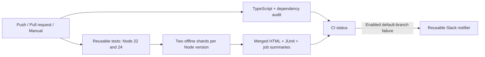

# Property Journey · Playwright & TypeScript

A real-estate automation portfolio that preserves the depth of a larger test framework: reusable page objects, typed fixtures, data-driven scenarios, multi-step journeys, persisted-state assertions, and failure diagnostics.

This is a sanitized source showcase, not a replacement website. Major historical flows remain available for code review even when the current website no longer exposes them. The website suites are deliberately opt-in; the default command and GitHub Actions run offline checks only.

## Start here

```sh
npm ci
npm run typecheck
npm test
```

No browser, target URL or credentials are needed for these checks. GitHub Actions runs TypeScript checks, a dependency audit and sharded offline tests on Node 22 and 24, then publishes merged offline HTML/JUnit reports.

## Engineering worth exploring

| Example | What it demonstrates |
| --- | --- |
| [Collection lifecycle](tests/search/02savedCollectionCrud.spec.ts) | Discover an unsaved property; create a named collection; verify membership; rename; remove the property; delete that collection; assert the final state. |
| [Search filters](tests/searchFilters/searchFilters.spec.ts) | Valid price bounds, property types, beds and baths across multiple locations; URL and visible-card assertions; saving and editing the resulting search. |
| [Onboarding](tests/auth/onboarding.spec.ts) | Location, budget, estimate recalculation, optional mortgage steps, property preferences, submission and persisted-profile assertions. |
| [Tour scheduling](tests/tour/requestTourActive.spec.ts) | Dashboard and search entry points; available/disabled slots; changing selections; phone collection; agreement handling; verification in dashboard Tours. |
| [Listing tour entry](tests/tour/requestTourListingPage.spec.ts) | Bounded candidate discovery, listing-detail entry and cross-page verification of the selected property. |
| [Listing disclosures](tests/mls-listing-page/mlsListingPage.spec.ts) | Multiple properties and markets; listing attribution, timestamps, contact details, disclosure copy and placeholders. These are UI checks, not a certification of legal compliance. |
| [Browse validation](pages/search/BreadcrumbPage.ts) | County navigation, broken-link detection, bounded sampling, collected warnings and diagnostic reports. Empty samples fail rather than silently skipping. |
| [Mortgage diagnostics](tests/mortgage/mortgageQualifyHrefTiming.spec.ts) | Navigation timing and changing qualification links; related specs cover navigation and a multi-step VA loan form. |
| [Assistant financing](utils/assistant/financingJourney.ts) | Bounded conversational turns, repeated-question detection, review-value assertions, explicit confirmation, and purchase/refinance branches. |
| [Toast capture](utils/toastRecorder.ts) | Preserve short-lived UI notifications for assertions after a transition. |
| [Replayable fixtures](fixtures/base.fixture.ts) | A per-test random seed recorded in the test output, with deterministic choices and isolated streams for parallel async helper work. |

## Suites and execution status

| Suite | Contents | Execution |
| --- | --- | --- |
| `tests/unit` | **58 offline regressions**: question parsing, submission state, random replay, generator safety/drift and mocked Slack delivery | Default command and CI |
| `tests/assistant` | **16 scenarios**: chat smoke, five home searches, four tour journeys, four purchase and two refinance journeys | Explicit browser command; three browser projects |
| Feature folders under `tests/` | **20 detailed historical scenarios** across 17 spec files: authentication, onboarding, search, saved collections, browse navigation, listing disclosures, tours, agreement restrictions, estimates and mortgages | Separate explicit command; Chromium |

The browser suites were compiled and their test discovery checked during preparation. They were **not executed against a website**. Sign-in/sign-up and other removed UI features remain references; their presence does not imply current compatibility. A green offline build verifies helper behavior, not the live application.

## Structure

```text
pages/                  Detailed UI page objects grouped by feature
fixtures/               Typed auth, isolated discovery and replay fixtures
common/testData/        Synthetic assistant scenarios and illustrative locations
config/                 UI adapter and configurable example API paths
utils/                  Journey runners, toast capture, identities, pure classifiers
tests/unit/             Offline regression checks
tests/assistant/        Modern conversational journey examples
tests/auth/             Authentication and onboarding references
tests/search*/          Search, filters and saved collections
tests/tour/             Tour references
tests/mortgage/         Mortgage references
tests/...               Other feature references
```

## GitHub Actions showcase

| Workflow | Demonstrated behavior |
| --- | --- |
| [Generator](scripts/generate-workflows.js) | Validated workflow registry, shared Action pins, Node matrix and shard settings, readable templates, deterministic generation, drift checks, and cleanup restricted to generated files. |
| [CI](.github/workflows/checks.yml) | Push/PR/manual triggers, generation-drift checks, independent quality and test jobs, dependency audit, cancellation of superseded runs, and a final `CI status` gate. |
| [Reusable offline tests](.github/workflows/unit-tests.yml) | `workflow_call` with a Node version input; Node 22/24 callers; two shards per version; GitHub failure annotations; merged HTML/JUnit reports; job summaries; artifacts retained for 3–7 days. |
| [Manual browser smoke](.github/workflows/browser-smoke.yml) | An opt-in Chromium/Firefox/WebKit matrix, browser dependency installation, environment-scoped configuration, and a non-submitting assistant introduction check. No website artifacts are uploaded. |
| [Reusable Slack notifier](.github/workflows/notify-slack.yml) | Optional failure alerts with public run metadata; default-branch push/manual events only; explicit secret mapping; bounded delivery timeout and redacted errors. |
| [Dependabot](.github/dependabot.yml) | Weekly grouped development-dependency updates and updates to pinned Actions. |



Actions are pinned to full commit SHAs with version comments; checkout credentials are not persisted. Workflows use read-only repository permissions and GitHub-hosted runners. Fork pull requests run offline checks without account secrets. Reports contain only offline test results; website traces, screenshots, browser contexts and `.env` are not uploaded. Sharding here demonstrates how to scale a larger suite; the small helper suite does not need four runners for speed.

After pushing, look under **Actions → Playwright CI** for job summaries and `offline-report-node-22` / `offline-report-node-24` artifacts. Download a report and open `html/index.html`, or consume `junit.xml` with a test-results tool. Use **CI status** as the required branch-protection check if you enable branch protection. No workflows were triggered on GitHub during preparation; local validation does not prove a hosted run succeeded.

### Workflow generator

Edit [config/workflows.json](config/workflows.json) for Node versions, shard count, shared Action SHAs, the browser environment and smoke filter. Edit [.github/templates](.github/templates) for job behavior. The generated `.github/workflows/*.yml` files are committed outputs, not the place for manual changes.

```sh
npm run generate:workflows
npm run workflows:check
```

Generation rejects path traversal, duplicate workflow names, invalid matrices and unpinned external Actions. `--check` reports drift without rewriting files. Normal generation removes obsolete files only when they carry this generator's header, preserving handwritten workflows. CI and unit tests validate the generated output. Action-pin updates proposed by Dependabot must also be applied to the registry and regenerated; otherwise the drift check intentionally fails. No production/staging schedule, infrastructure bypass or private account-secret list is copied from the original generator.

### Optional Slack notifications

Set the repository variable `ENABLE_SLACK_NOTIFICATIONS=true` and add `SLACK_WEBHOOK_URL` as a **GitHub Actions secret** using your own Slack incoming webhook. Do not add the webhook to `.env.example`, the registry, templates or YAML. See [Slack's incoming-webhook documentation](https://docs.slack.dev/messaging/sending-messages-using-incoming-webhooks/) for setup.

The CI and manual smoke workflows call the shared notifier on failures only. Both caller and callee restrict delivery to the default branch; the reusable notifier accepts only push/manual events, preventing PR-triggered sends. There is no `secrets: inherit`; only the explicitly named webhook secret reaches the notification job. With notifications disabled or the secret absent, no message is sent.

Messages contain the public repository name, workflow, scope, result and GitHub run link. They exclude raw failures, account information, traces, screenshots and test replies. The sender permits HTTPS Slack incoming-webhook hosts only, refuses redirects, uses a ten-second timeout and omits webhook/response details from errors. A delivery failure produces a workflow warning and cannot turn failed tests green. Every delivery test uses an injected mock fetch implementation; preparing or testing this source sends no live Slack messages.

The manual browser example is disabled until you set the repository variable `ENABLE_BROWSER_DEMO=true`. It runs only from the default branch. Create a `public-demo-browser` environment, configure its `DEMO_BASE_URL` and `CHAT_*` variables for an authorized **public, non-sensitive** target, and optionally configure required reviewers on that environment. Do not put internal hostnames, private staging configuration, credentials or URL tokens into this public workflow. Select a browser or `all` using **Actions → Manual browser smoke example → Run workflow**. This workflow never selects tour/financing submission specs or historical authentication flows. You must adapt the UI adapter before expecting it to pass.

The matrix and merged-report approach follows [Playwright's sharding guidance](https://playwright.dev/docs/test-sharding); action pinning and minimal permissions follow [GitHub's secure-use guidance](https://docs.github.com/en/actions/reference/security/secure-use).

## Optional browser execution

Use an authorized test website and dedicated accounts. No website is included here.

```sh
cp .env.example .env
# Configure your local target, selectors, example contracts and test accounts.
npx playwright install chromium

# Modern assistant examples:
npm run test:e2e -- --project=chromium

# Historical references, after adapting the target UI/contracts:
npm run test:reference -- --grep 'saved listing collection'
```

Both browser commands reject a missing `BASE_URL`. `npm run test:e2e` selects only assistant examples. `npm run test:reference` selects only historical examples. Full browser suites are excluded from automatic CI; the separate manual workflow selects only the introductory assistant smoke test. Use `--list` to inspect discovery without launching browsers.

For replayable historical choices, set `TEST_SEED` before running. The framework combines it with the test title and records the resulting seed. Changing the seed explores a different valid selection; it cannot freeze changing live inventory.

Authentication fixtures use fresh contexts and environment-supplied accounts. There is no mailbox access, database-backed account counter, saved session cache or infrastructure bypass. Passwordless page-object methods accept a caller-supplied code; no OTP service is bundled. Some reference page objects synchronize UI actions with configured network responses; `config/contracts.ts` contains neutral example paths rather than private endpoints.

## Adaptation points and known limitations

- Historical selectors, routes, text and expected product behavior need review against the intended website. Network response shapes are example contracts; path configuration alone is not sufficient to retarget every assertion.
- Location availability, regional restrictions and rebate calculations are illustrative product expectations, not a service-coverage map or financial guidance. Adapt these rules to the target.
- Onboarding requires an already seeded, unfinished account. The demo does not create backend accounts. Tour fixtures require an account with an appropriate active market. Configure every account key needed by the chosen spec.
- Live inventory can leave no matching property or appointment. Bounded discovery fails with context rather than inventing success. Some inherited helpers still use fixed waits and UI fallbacks; a working target is needed to validate and tighten them.
- Tour/financing examples can create requests, onboarding can update preferences, and collection/search examples mutate their dedicated account. Signup demonstrates form entry without completing registration. No browser flow was run as part of this preparation.
- The collection CRUD test removes its own newly named collection. Account-wide random cleanup and editing an arbitrary existing saved search were excluded. Other reference mutations do not all implement rollback; use disposable test accounts.

## Public source hygiene

`.env.example` contains placeholders. Local `.env`, authentication state, dependencies, reports, traces, recordings, exports and generated artifacts are ignored. Browser recording is off by default; explicit website specs may still create local diagnostic attachments, screenshots and browse reports. Those can contain target/account data and are not part of the public source export.

Automatic test jobs need no account secrets and upload only offline-test reports. Optional Slack notifications use one explicitly mapped webhook secret in an isolated notification job. The optional manual browser workflow also receives no account secrets and uploads no website artifacts; failure logs may still contain target UI text. Configured secrets, company branding, hosted private URLs, private integrations and original recordings are excluded from this source showcase. Scanning reduces exposure risk; it cannot guarantee every future edit or generated artifact is safe to share.

To export just the source:

```sh
python3 scripts/export-demo.py /absolute/path/outside-this-repo/property-journey.zip
```

The exporter uses a source allowlist and excludes `.git`, credentials, dependencies and runtime evidence. Publish a clean snapshot in a new repository; never copy the history of the original private project.
